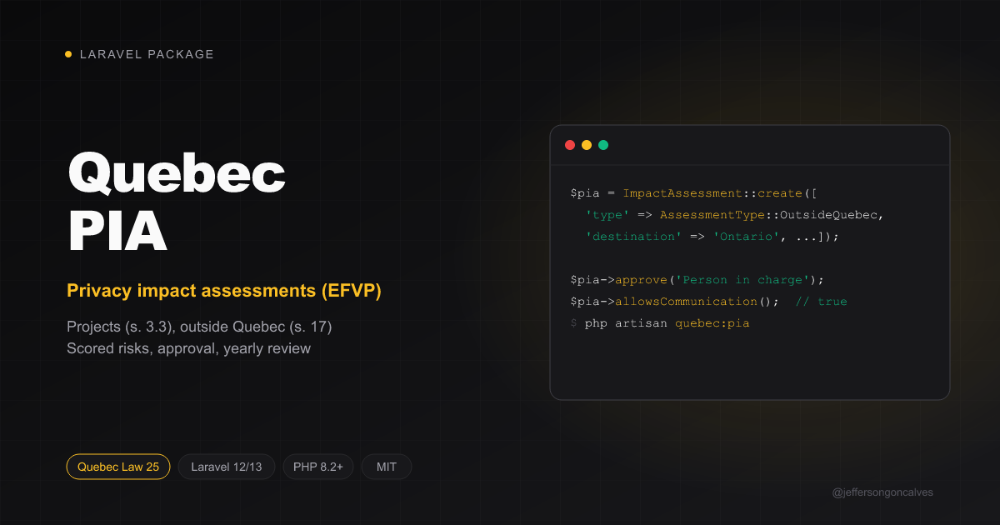

# Laravel Quebec PIA



[](https://packagist.org/packages/jeffersongoncalves/laravel-quebec-pia)
[](https://github.com/jeffersongoncalves/laravel-quebec-pia/actions/workflows/tests.yml)
[](https://packagist.org/packages/jeffersongoncalves/laravel-quebec-pia)

Privacy impact assessments (*évaluations des facteurs relatifs à la vie privée*, EFVP) under Quebec's private sector privacy act (Law 25). It is part of the [laravel-quebec](https://github.com/jeffersongoncalves/laravel-quebec) suite.

Law 25 asks for an assessment:

- for any **project** to acquire, develop or overhaul an information system or electronic service delivery involving personal information. Consult the person in charge of the protection of personal information from the outset, and make sure the system can communicate computerized information in a structured, commonly used technological format (s. 3.3);
- **before communicating personal information outside Quebec**, taking into account its sensitivity, the purposes, the protection measures, including contractual ones, and the legal framework of the destination. Communicate only if the information would receive adequate protection (s. 17);
- before communicating information for **study, research or statistics** without consent (s. 21).

The assessment is proportionate to the sensitivity, purpose, quantity, distribution and medium of the information.

> This package gives you tooling. It does not make you compliant on its own. You still need legal review, for example of the destination's legal framework.

## Installation

```bash
composer require jeffersongoncalves/laravel-quebec-pia
php artisan vendor:publish --tag="quebec-pia-migrations"
php artisan migrate
php artisan vendor:publish --tag="quebec-pia-config"
```

It links assessments to the processing activities of [laravel-quebec-governance](https://github.com/jeffersongoncalves/laravel-quebec-governance).

## Usage

```php
use JeffersonGoncalves\QuebecPia\Enums\AssessmentType;
use JeffersonGoncalves\QuebecPia\Models\ImpactAssessment;

$pia = ImpactAssessment::create([
    'title' => 'Hosting in Ontario',
    'type' => AssessmentType::OutsideQuebec,
    'processing_activity_id' => $hosting->id,
    'destination' => 'Ontario',
    'legal_framework' => 'PIPEDA applies; contract clauses on confidentiality and audits',
    'adequate_protection' => true,
    'person_in_charge_opinion' => 'Favourable',
    'risks' => [
        ['title' => 'Unauthorized access by the host', 'threat' => 'data_disclosure', 'likelihood' => 2, 'impact' => 3,
         'measures' => 'Encryption at rest, keys kept in Quebec', 'residual_likelihood' => 1, 'residual_impact' => 3],
    ],
]);

$pia->scoredRisks();          // level and residual level per risk (likelihood x impact)
$pia->highestRisk();          // RiskLevel::Medium
$pia->approve('Marie Tremblay (person in charge)');
$pia->allowsCommunication();  // true: approved, with adequate protection
```

- Risks are scored 1–3 for likelihood and impact (1–2 low, 3–4 medium, 6–9 high), with an optional LINDDUN threat.
- Approving needs at least one risk; an outside-Quebec assessment also needs the destination and a conclusion on adequate protection.
- Editing an approved assessment sends it back to draft. Approval holds for `quebec-pia.review_every` (default 1 year).

### Candidates

```php
use JeffersonGoncalves\QuebecPia\Facades\QuebecPia;

QuebecPia::candidates();
// [['activity' => ProcessingActivity, 'reasons' => ['sensitive', 'profiling', 'outside_quebec']], ...]
```

An activity is a candidate when it processes sensitive information or uses profiling without a project assessment, or communicates information outside Quebec (on the activity, or a column declared `outsideQuebec: true`) without an outside-Quebec assessment.

```bash
php artisan quebec:pia
php artisan quebec:pia --json
```

## Testing

```bash
composer test
```

## Changelog

See [CHANGELOG](CHANGELOG.md).

## License

The MIT License (MIT). See [License File](LICENSE.md).
